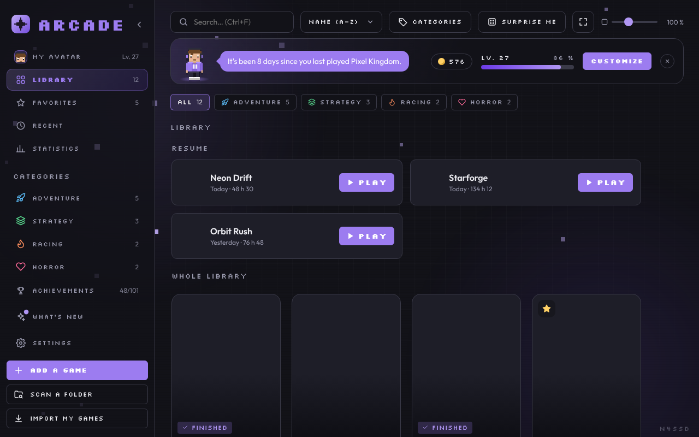
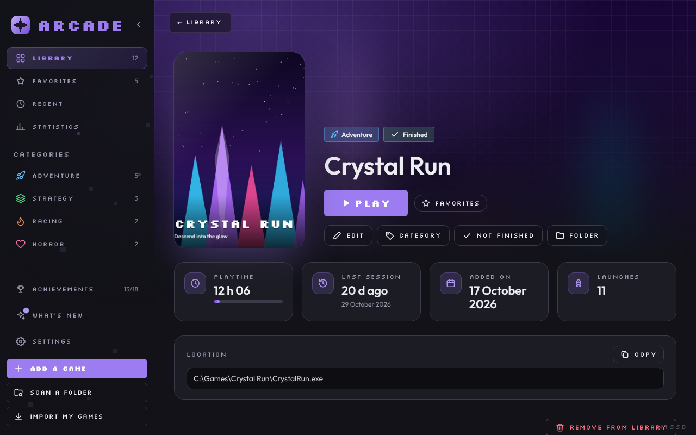
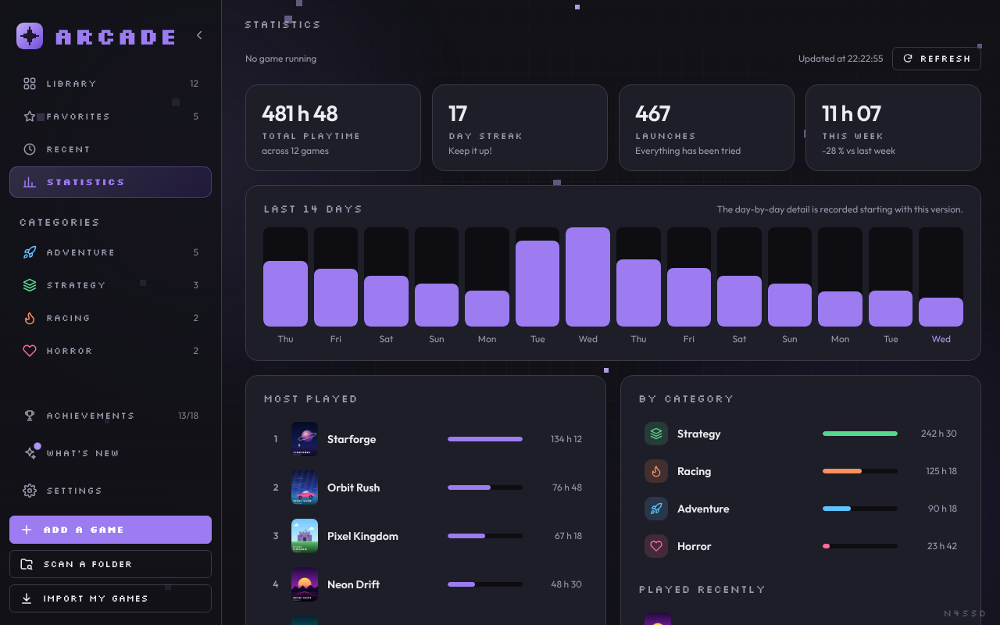
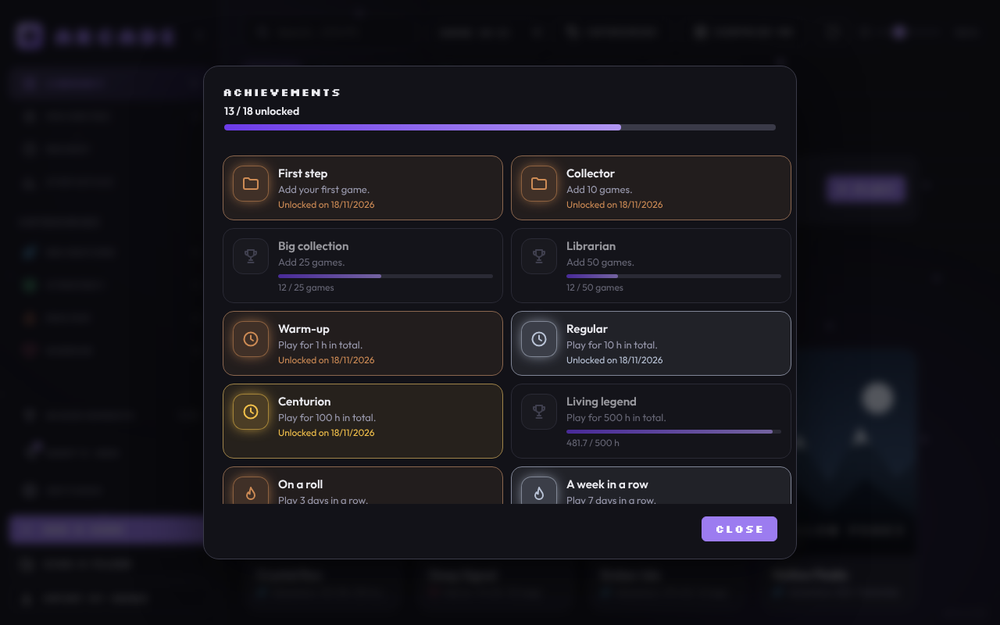
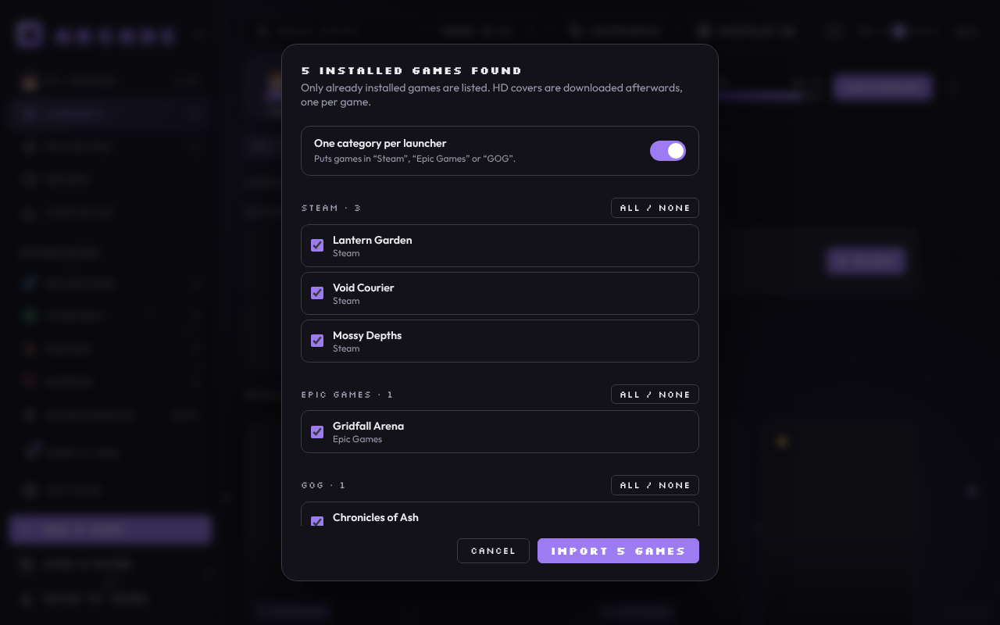
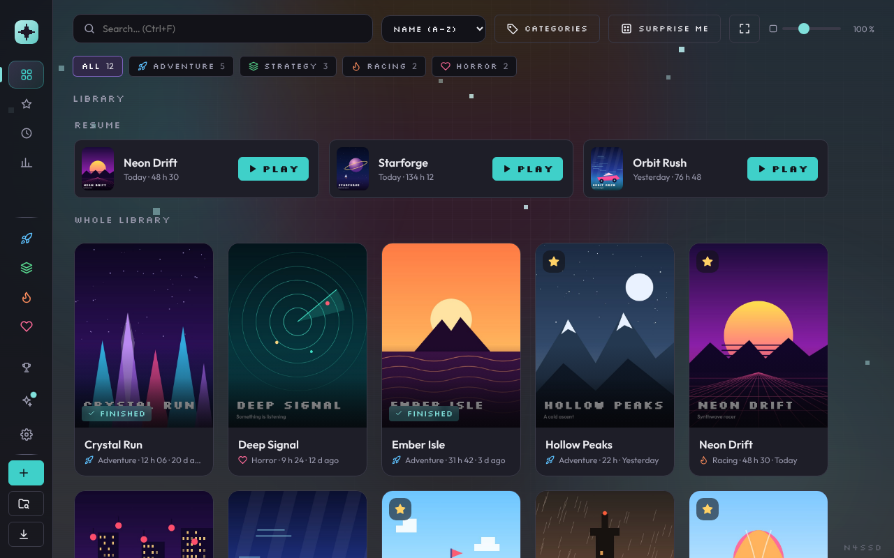
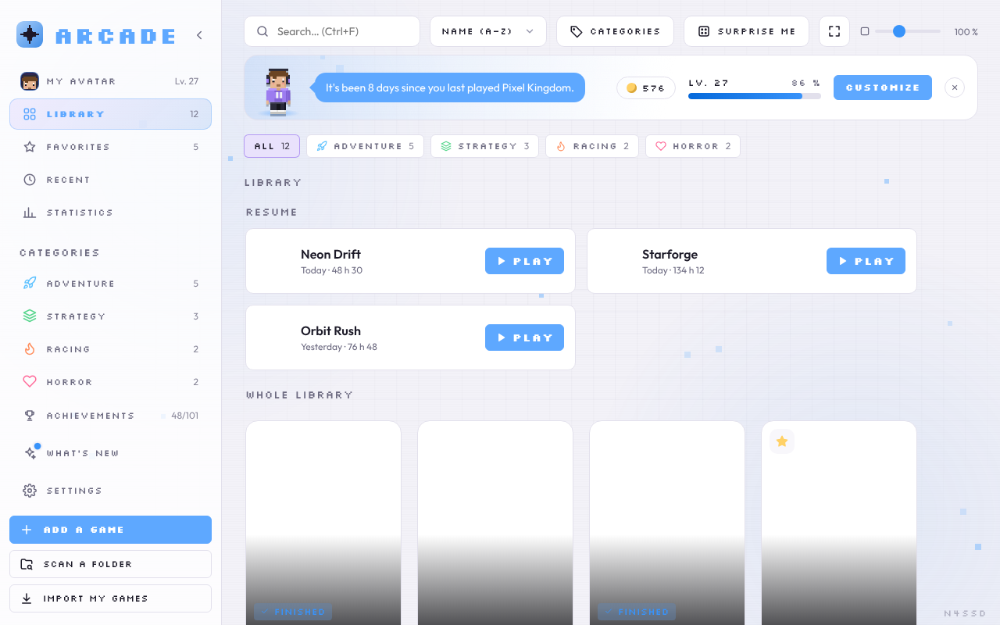
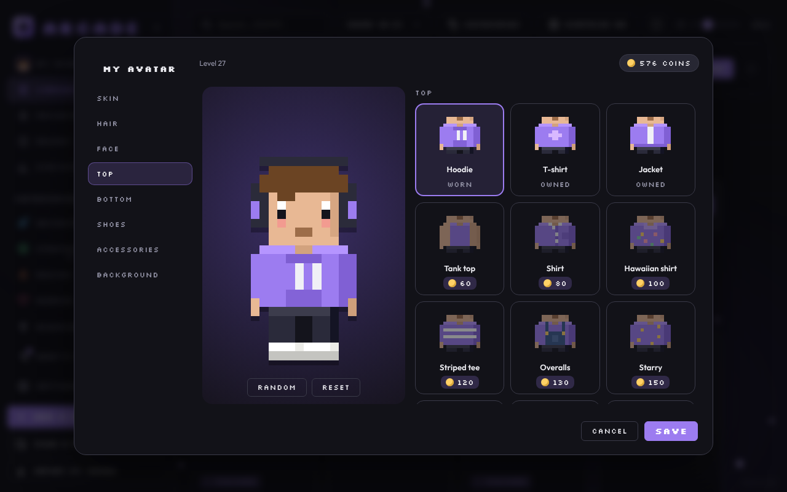
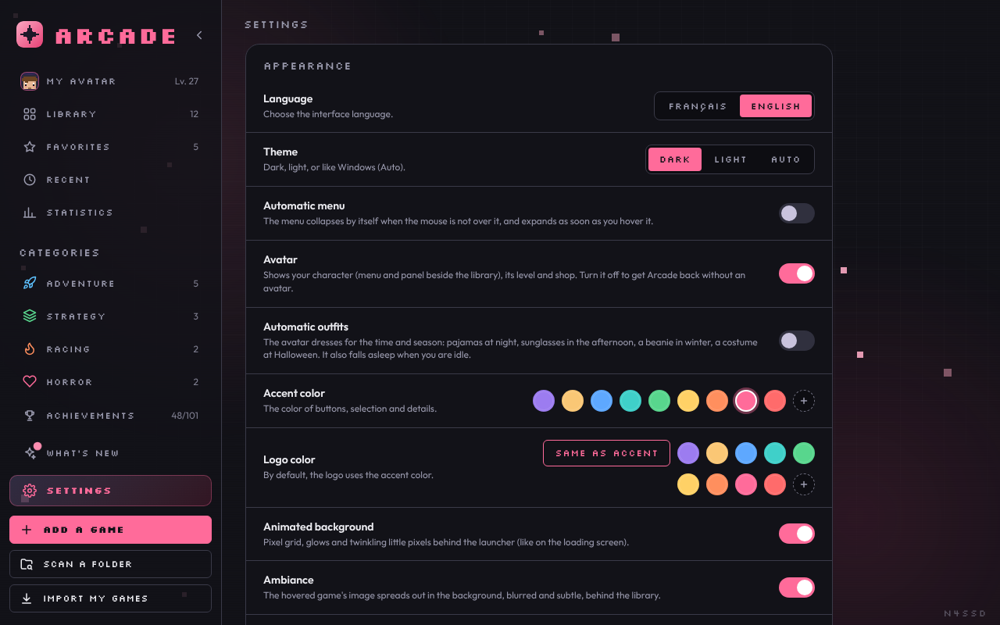

<div align="center">

# Arcade

**A fast, good-looking game launcher for Windows.**
Your library, your play time and your achievements, in one place.

[**⬇ Download ArcadeSetup.exe**](https://github.com/N4ssD/Arcade/releases/download/dernier/ArcadeSetup.exe) · [Releases](../../releases) · [Changelog](CHANGELOG.md)



</div>

Arcade is a standalone desktop app written in **Rust** ([Tauri 2](https://tauri.app)). One small installer, no accounts, no telemetry, nothing else to install.
Add your games from anywhere (Steam, Epic, GOG, plain `.exe` files, shortcuts), and Arcade keeps track of how long you play.

## Screenshots

> Screenshots use demo data and original artwork made for this page.

| | |
|---|---|
|  |  |
| **Game page** with play time, last session and launches | **Live statistics**: streaks, weekly trend, most played, by category |
|  |  |
| **100+ achievements** to unlock, with coin rewards | **One-click import** of your Steam, Epic and GOG games |
|  |  |
| **Auto-hiding menu** that pushes the content as it opens | **Light and dark themes**, any accent color |
|  |  |
| **Pixel avatar** with hairstyles, outfits and a coin shop | **Settings**: sounds, performance, appearance, updates |

## Features

**Library**
- Automatic HD covers (from Steam), game icons, categories with colors and icons, favorites, search and sorting
- Add games by **drag and drop** (`.exe`, `.lnk`, `.url`), with the file picker, or by scanning a folder
- Import installed games from **Steam, Epic Games and GOG**
- A **Resume** row for what you played last, and a **Surprise me** button when you cannot decide
- **Library check**: finds games whose file disappeared and duplicates, and merges them (play time is added up)

**Play**
- **Live play time** and statistics, with optional break reminders
- Launch arguments and **run as administrator**, per game
- Arcade minimizes itself while you play and **comes back when the game closes**
- Starts with Windows, can stay in the **notification area**

**Look and feel**
- Soft **ambient music**, generated live, with its own volume and an off switch
- A customizable **pixel avatar** with a level, coins and unlockable outfits, who comments on your games (can be turned off)
- **English and French** (Settings > Appearance)
- Dark, light or automatic theme, custom accent color and logo color
- Auto-hiding menu, expanded or collapsed on demand (click the logo to cycle between *auto*, *always open* and *always closed*)
- Optional animated background, ambient glow and idle slideshow; a power-saving mode pauses animations while a game runs
- Pixel-art typography ([Silkscreen](https://github.com/googlefonts/silkscreen) and [Outfit](https://github.com/Outfitio/Outfit-Fonts)), gamepad navigation, TV mode

**Installer and updates**
- Built-in installer: pick the folder, shortcuts, update and uninstall (also from Settings)
- **Automatic updates**: Arcade checks for a new version and installs it in one click
- Your data stays on your PC, in the `data` folder inside the install folder

## Download

1. Download **[ArcadeSetup.exe](https://github.com/N4ssD/Arcade/releases/download/dernier/ArcadeSetup.exe)** from the [Releases](../../releases) page.
2. Run it. The installer lets you choose the folder and the shortcuts. The installed app is called `Arcade.exe`.

> **Windows may show "Windows protected your PC" (SmartScreen).**
> The executable is not code-signed yet, which is normal for a small open-source project and not a sign of malware.
> Click **More info**, then **Run anyway**, or read the whole source code here.

Requirements: Windows 10 or 11 (64-bit). The WebView2 runtime is already included with both.

After installation the folder contains:

| File | Purpose |
|---|---|
| `Arcade.exe` | The application |
| `data\library.json` | Your library and settings |
| `data\covers`, `data\icons` | Cover art and game icons |
| `data\arcade.log` | Log file, useful if something goes wrong |

To uninstall: Windows Settings > Apps > Arcade, or Arcade's own Settings > Maintenance.

## Privacy

Arcade has no account and no telemetry. It only goes online for two things:

- **Covers**: the name of a game is sent to the Steam store search to find its cover (can be turned off in Settings).
- **Updates**: Arcade reads the latest version number from this repository and downloads `ArcadeSetup.exe` from the Releases page when you accept an update (can be turned off in Settings).

## Built with

- **Rust** ([Tauri 2](https://tauri.app)): the app itself, the window, the library, launching games, covers, the installer and the updater.
- **HTML / CSS / JavaScript**: the interface, displayed in the app window (WebView2). It has no dependencies and no build step. This is why GitHub also lists JavaScript and CSS: it is the drawing of the screen, not a separate program.
- A small PowerShell script (`src-tauri/src/icon.ps1`), used only to extract game icons.

The previous complete version (PowerShell) is still available in the [`powershell-1.19`](../../tree/powershell-1.19) branch.

## Build from source

Nothing needs to be installed on your PC: **GitHub Actions** builds the executable (see the **Actions** tab). Every push to `main` publishes the latest build to the `dernier` release.

Local build (Windows, with Rust installed):

```
cargo build --release --manifest-path src-tauri/Cargo.toml
```

The executable is then in `src-tauri/target/release/arcade.exe`. Running it from there starts the installer; run it with `--portable` to skip the installer.

## Repository layout

| Folder | Content |
|---|---|
| `src-tauri/` | The Rust code (`src/main.rs`), the Tauri configuration and the icons |
| `ui/` | The interface (HTML, CSS, dependency-free JavaScript split into `app-*.js` files) and the embedded fonts |
| `docs/screenshots/` | The images used on this page |
| `.github/workflows/` | Automatic build and publishing |

## Releasing a new version

Use the same version number in `src-tauri/Cargo.toml`, `src-tauri/tauri.conf.json`, `VERSION` in `src-tauri/src/main.rs` and `APP_VERSION` in `ui/app-core.js`.
Also add an entry to `CHANGELOG.md` and to the `CHANGELOG` list in `ui/app-news.js` (the "What's new" button). The updater compares the version in `src-tauri/Cargo.toml` on `main` with the installed one.

## Code signing policy

Arcade's Windows installer is **not signed yet**. An application to the free [SignPath Foundation](https://signpath.org) open-source program is planned; once accepted, release builds will be signed with this policy:

- **Free code signing provided by [SignPath.io](https://signpath.io), certificate by [SignPath Foundation](https://signpath.org).**
- **Only CI-built artifacts** are signed: `ArcadeSetup.exe` is built from this repository's source by the public GitHub Actions workflow (`.github/workflows/build.yml`) and published on the Releases page.
- **Team roles**: author, reviewer and approver: [N4ssD](https://github.com/N4ssD) (sole maintainer). Every signing request needs manual approval, and multi-factor authentication is required on the repository and on SignPath.
- **Privacy**: see the [Privacy](#privacy) section above. Arcade installs and uninstalls cleanly (Windows Settings > Apps > Arcade) and asks before changing anything else on the system.

## License

[MIT](LICENSE) © N4ssD. Fonts: see [NOTICE.md](NOTICE.md).
